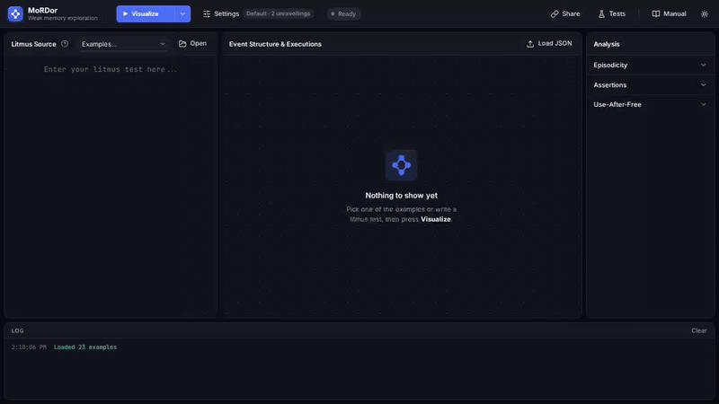

[](https://github.com/christiankissig/mordor/actions/workflows/ci.yml) [](https://github.com/christiankissig/mordor/actions/workflows/litmus-tests.yml) [](https://github.com/christiankissig/mordor/actions/workflows/episodicity-tests.yml)


# MoRDor - Weak Memory Explorer

MoRDor is a tool for exploring weak memory. Given a concurrent C-like program as
a litmus test, it computes the program's justified executions: the ways its
reads and writes can resolve under relaxed memory, each backed by
justifications of what every write depends on. A memory model then decides
which executions are coherent. Because every execution carries the
justifications it was built from, MoRDor shows not only which outcomes a model
allows but why.

MoRDor is a reference implementation of Symbolic Modular Relaxed Dependencies
(SMRD)
["Symbolic MRD: Dynamic Memory, Undefined Behaviour, and Extrinsic Choice" by Jay Richards, Daniel Wright, Simon Cooksey, Mark Batty](https://2025.splashcon.org/details/OOPSLA/104/Symbolic-MRD-Dynamic-Memory-Undefined-Behaviour-and-Extrinsic-Choice).

**Caveat** Do not use until version 1.

<picture>
  <source media="(prefers-color-scheme: light)" srcset="demo/out/mordor-demo-light.gif">
  
</picture>

The web UI above finds a use-after-free reachable when the flag is written with
a relaxed store, then confirms it is gone once the store is made releasing.

The same analysis from the command line:


See [demo/README.md](demo/README.md) for how the recordings are produced
(`make demo` and `make demo-cli`). Every command in the CLI clip is really run —
the output on screen is captured from `mordor` itself.

## Overview

MoRDor explores weak memory through justified executions. It interprets a
program symbolically as an event structure, derives justifications for its
writes, freezes them into executions with their dependencies, and checks those
executions against memory models: sMRD, RC11 and IMM, and 36 more models of
the [Relaxed Memory Model Zoo](https://rmm-zoo.kissig.org) defined over the
same relations, from SC and TSO through the C/C++ standards, Java, WebAssembly
and OCaml to the release-acquire family and the session guarantees. It can also compute a program's executions under promising
semantics 1.0 (Kang et al., POPL 2017) and 2.0 (Lee et al., PLDI 2020), which
are operational: promises, certification and per-thread views instead of
justifications.

The command-line interface and web UI provide:
- Parsing and validating programs and litmus tests
- Computing and visualising event structures, justifications and executions
- Checking `allow` and `forbid` assertions under a memory model, and comparing
  models execution by execution
- Computing executions under promising semantics, and comparing them with the
  other models by outcome
- Deciding episodicity of unbounded loops
- Finding use-after-free

The web UI's manual, at `/manual/` on a running server
([web/frontend/manual.html](web/frontend/manual.html)), explains the concepts,
the UI and the litmus test language.

## Memory Models

A litmus test names its model in the assertion's annotation, e.g.
`allow (r1 = 1) [RC11]`; names are case-insensitive. A test that names none runs
under sMRD.

| Annotation | Model |
|---|---|
| `smrd` | Symbolic MRD (Richards et al., OOPSLA 2025): dependencies, preserved program order, release/acquire synchronisation (fences and release sequences included), RC11's SC order (psc) and lock order. The default. |
| `mrd` | Modular Relaxed Dependencies: sMRD's axioms, on programs that access only named globals and allocate nothing; others are refused. |
| `rc11`, `rc11c` | Repaired C11 (Lahav et al., PLDI 2017), and RC11 with consume, which for now answers as RC11: consume has no semantics of its own yet. |
| `rc17` | RC11 with C++17's release sequences. |
| `rc11z` | RC11 with allocations and frees ordered as writes. |
| `c11`, `c17`, `c20` | The C11, C++17 and C++20 standards; also `cpp11`, `cpp17`, `cpp20`. They allow out-of-thin-air executions. |
| `orc11` | Operational RC11 (Dang et al., POPL 2020): RC11 without SC accesses or SC fences. |
| `rar` | RC11's release-acquire/relaxed fragment (Doherty et al., PPoPP 2019). |
| `crc` | The C11 fragment of Dodds, Batty and Gotsman (ESOP 2018): release-acquire and catch-fire non-atomic accesses, SC fences. |
| `drfx`, `denovosync` | SC for data-race-free programs, a race being undefined (Marino et al., PLDI 2010; Sung and Adve, ASPLOS 2015). |
| `jam` | Java Access Modes (Bender and Palsberg, OOPSLA 2019): `na` is plain, `rlx` opaque, `acq`/`rel` release-acquire, `sc` volatile. |
| `bmm` | The buffered memory model for Java (Demange et al., POPL 2013): TSO with volatile (`sc`) accesses kept in order. |
| `wasm` | WebAssembly (Watt et al., OOPSLA 2019): `sc` accesses seqcst, the rest unordered. |
| `ocaml` | The OCaml memory model (Dolan et al., PLDI 2018): `sc` accesses to atomic locations, the rest non-atomic. |
| `od-lso` | Ou and Demsky's load-store ordering over C/C++11. |
| `imm` | The Intermediate Memory Model (Podkopaev et al., POPL 2019). |
| `sc`, `vbd` | Sequential consistency, and Volatile-by-Default. |
| `tso`, `x86-tso`, `clighttso` | Total store order. |
| `ra`, `sra`, `wra` | Release-acquire, strong and weak release-acquire. |
| `cc` | Weak causal consistency. |
| `coherence` | Per-location cache coherence. |
| `pc`, `pram`, `causal`, `slow`, `local` | Steinke and Nutt's lattice. |
| `pocausal` | Per-object causal consistency. |
| `ryw`, `mr`, `mw`, `wfr` | Terry et al.'s session guarantees. |
| `ps1`, `ps2` | Promising semantics 1.0 and 2.0, computed operationally (or `--semantics ps1\|ps2`). |

Every model but `ps1` and `ps2` checks the executions sMRD derives. Every model
here but `rc11c` is one of the
[Relaxed Memory Model Zoo](https://rmm-zoo.kissig.org). A model defined on a
fragment of programs (`mrd`, `orc11`, `rar`, `crc`, `drfx`, `denovosync`,
`bmm`, `jam`, `wasm`, `ocaml`) refuses a program outside it, naming the event
that is. Only sMRD and MRD, and promising semantics, give locks a semantics:
every other model refuses a program with `lock` or `unlock` the same way.

`Power` runs under `imm`, and `_` under the default. `UB11`, `RC11UB` and
`IMMUB` are sMRD, `rc11` and `imm` with optimisations that exploit undefined
behaviour. Any other name is an error unless `--allow-unknown-model` is given;
`litmus-tests-jmm/` keeps tests for the Java Memory Model, which MoRDor does not
implement.

## Project Structure

```
mordor/
├── dune-project
├── README.md
├── Dockerfile
├── docker-compose.yml
├── Makefile
├── src/          # Core library (mordor_lib) — see src/README.md
├── cli/          # CLI entry point (mordor) — see cli/README.md
├── web/          # Web server (mordor-web) — see web/README.md
├── wasm/         # The browser build: MoRDor in a Web Worker — see wasm/README.md
├── test/         # Unit and integration tests
├── litmus-tests/ # Litmus test suite
└── programs/     # Sample concurrent programs
```

- `src/`: Core analysis library shared by CLI and web server. See [src/README.md](src/README.md).
- `cli/`: `mordor` executable — argument parsing, pipeline orchestration. See [cli/README.md](cli/README.md).
- `web/`: `mordor-web` Dream server — SSE streaming, REST API, browser UI. See [web/README.md](web/README.md).
- `wasm/`: MoRDor compiled to JavaScript, with Z3 compiled to wasm, in a Web Worker; the static playground. See [wasm/README.md](wasm/README.md).
- `test/`: Alcotest unit tests (`dune test`) and integration tests (`dune build @integration`, or `dune exec test/test_integration.exe`).
- `litmus-tests/`: Litmus test suite run by CI.
- `programs/`: Hand-written sample programs including episodicity examples.

## Building the MoRDor Web UI

It is recommended to build and run MoRDor in Docker using the Makefiles. See the
[Docker Guide](DOCKER_GUIDE.md) for details.

```bash
make build # build the Docker container image
make run   # run the Docker container
make stop  # stop the Docker container
make clean # clean up
```

## MoRDor in the Browser

MoRDor also runs entirely in the browser, without a server: the
[playground](https://christiankissig.github.io/mordor/playground/), published
from each release, or from master when the Pages workflow is run by hand, is the web UI with MoRDor compiled to JavaScript
(js_of_ocaml) and Z3 compiled to wasm, in a Web Worker. Its answers are the
server's, message for message.

It differs from the native build in that it runs on one thread; it is slower,
a few times over on small tests, mostly in starting, and 1.2 to 1.5 times on a
program like seqlock-1; Z3's memory is capped at 4 GB; and it writes no files
and has no command line.

To build and run it locally (see [wasm/README.md](wasm/README.md)):

```bash
wasm/z3/build.sh WORK                 # Z3 for wasm, once: about 20 minutes, 3.5 GB in WORK
opam install js_of_ocaml-compiler js_of_ocaml zarith_stubs_js
dune build ./web/export_static.exe
dune build --profile browser --build-dir _build-js ./wasm/worker.bc.js
wasm/static.sh WORK/out SITE
python3 -m http.server -d SITE        # then open http://localhost:8000/
```

## Building the Executables

Build with Dune

```bash
dune build
```

Build and view documentation with

```bash
opam install odoc
dune build @doc
xdg-open _build/default/_doc/_html/index.html 
```

## Profiling

```bash
OCAML_LANDMARKS=on dune exec mordor
```

## Running

Run the CLI with

```bash
dune exec mordor
```

with stacktraces

```bash
OCAMLRUNPARAM=b dune exec mordor
```

It is recommended to run the Web interface in Docker as described in the
[Docker Guide](DOCKER_GUIDE.md).

```bash
make run
```

Run the Web UI locally with

```bash
dune exec mordor-web
```

## Formatting

The code is formatted with ocamlformat 0.29.0, the version `.ocamlformat`
pins, and CI fails on unformatted code. Format before pushing with

```bash
opam install ocamlformat.0.29.0
dune fmt
```

## Testing

Run the unit tests and the quick integration tests with

```bash
dune test
```

The litmus and episodicity suites take minutes, so `dune test` skips them and
says so: it prints `SKIPPED (--quick): <suite>, <n> cases` for each. Run all
integration tests (litmus tests, episodicity and the remaining integration
tests) and the golden check below with

```bash
dune build @integration
```

or the integration tests alone, from any directory of the checkout, with

```bash
dune exec test/test_integration.exe
```

The suites find their corpora from the project root, and fail rather than pass
with no cases when a corpus is not there.

The integration tests come in three suites, which can be run alone by name:

```bash
# Litmus tests: every .lit file under litmus-tests/, each assertion checked strictly
dune exec test/test_integration.exe -- test "Integration Tests - Litmus Tests Strict"

# Episodicity tests: the programs under programs/episodicity/ and their expectations
dune exec test/test_integration.exe -- test "Integration Tests - Episodicity"

# The remaining integration tests: --threads runs must agree with sequential ones
dune exec test/test_integration.exe -- test "Integration Tests - Parallel"
```

Each episodicity program gets 300 s before the suite gives up on it; set
`MORDOR_EPISODICITY_TIMEOUT` (in seconds) to change that. To run one test of a
suite, add its index, as in `... test "Integration Tests - Episodicity" 3`, and
`dune exec test/test_integration.exe -- list` lists the tests with their
indices.

The golden tests compare each litmus test's verdict and executions against a
recorded golden under `test/goldens/`:

```bash
dune build test/golden/golden_diff.exe
_build/default/test/golden/golden_diff.exe check    # compare
_build/default/test/golden/golden_diff.exe update   # re-record after an intended change
```

Run them from the repository root; `check` fails when it finds no litmus
tests. CI runs `check`.

They run each test under the default loop semantics, which unrolls loops, so
they see nothing of what symbolic loop semantics builds. The loop goldens do
(S8, #20): for each of 34 programs with a loop, the interpreted structure's
`po`, `po_iter`, `conflict` and `restrict`, and the tables `loop_indices` and
`loop_conditions`, under `loop_semantics = Symbolic`, against
`test/goldens-loops/<program>.structure`. CI runs `check`.

```bash
dune build test/golden/loop_goldens.exe
_build/default/test/golden/loop_goldens.exe check            # compare
_build/default/test/golden/loop_goldens.exe update FILE ...  # re-record those programs' goldens
```

`test/golden/equivalence.exe` is the equivalence harness for the bounded
paths (V1, #97). It runs every program under the enumeration and under each
bounded path -- futures from one witness per future, assertions by query -- and
diffs what is reported: the futures, each verdict and the witness the query
reports, and every execution a bounded path returns, which must be one the
enumeration returns. Executions are compared in canonical form, and where their
predicates differ as text the solver decides whether they are equivalent; the
count of syntactic, semantic and divergent matches is reported. `--flags-off`
compares the enumeration with itself, which must find nothing. Each program
runs in its own process, given 300 s (`--timeout`):

```bash
dune build test/golden/equivalence.exe
_build/default/test/golden/equivalence.exe                # the four corpora
_build/default/test/golden/equivalence.exe --flags-off    # the harness against itself
```

`check-regions` renders every test with allocations kept apart by their bases
only and by their addresses (`--overlapping-regions` against the default), and
lists every test whose verdict or executions differ:

```bash
_build/default/test/golden/golden_diff.exe check-regions litmus-tests litmus-tests-jmm
```

`check-query` decides every test's assertion twice, by enumeration and by
query (`run --by-query`, below), and fails if the verdicts differ. A test the
query cannot ask about is counted, not compared:

```bash
_build/default/test/golden/golden_diff.exe check-query litmus-tests litmus-tests-jmm
```

## Command Line Interface

MoRDor supports several commands for analyzing litmus tests and generating outputs.

### Commands

- **`run`**: Full verification pipeline — parse → interpret → dependencies → assertions
- **`parse`**: Parse a litmus test to IR only
- **`interpret`**: Parse and interpret to generate the event structure
- **`episodicity`**: Check loop episodicity (requires `--single`)
- **`visual-es`**: Visualize event structures (requires `--single`)
- **`futures`**: Compute future states (requires `--single`). By default from
  one witness execution per future rather than from every execution: the
  same futures, found per justification combination by a solver query (sMRD)
  or a search (other models). A combination neither settles within the budgets
  (`MORDOR_WITNESS_ROUNDS`, 50 solver rounds; `MORDOR_WITNESS_SECS`, 60 s of
  search) is reported as a warning that the futures may be incomplete.
  `--all-executions` computes them from every execution instead.
- **`executions`**: Export all executions with events and `po`/`dp`/`ppo`/`rf`/`rmw` relations as JSON (requires `--single`)
- **`dependencies`**: Compute dependency relations (not yet implemented)

### Options

#### Input Selection
- `--samples`: Use built-in sample programs (default)
- `--all-litmus-tests <dir>`: Process all `.lit` files in specified directory
- `-r`: Scan directories recursively (use with `--all-litmus-tests`)
- `--single <file>`: Process a single `.lit` file

#### Output Configuration
- `--output-mode <mode>`: Set output format
  - `json`: JSON format (visual-es, futures)
  - `dot`: Graphviz DOT format (visual-es)
  - `html`: HTML format (visual-es)
  - `isa`: Isabelle theory output (parse, futures)
- `--output-file <file>`: Output file path (default: stdout)

#### Loop Semantics
- `--step-counter <n>`: Global loop unrolling bound (default: 2)
- `--step-counter-per-loop <n>`: Per-loop unrolling bound
- `--symbolic-loop-semantics`: Symbolic loop representation (required for `episodicity`)

#### Execution
- `--threads <n>`: Number of parallel threads (default: 1)
- `--semantics smrd|ps1|ps2`: The semantics executions are computed under:
  sMRD (default), or promising semantics 1.0 or 2.0. A test annotated `[PS1]`
  or `[PS2]` selects its version without the option; the option takes
  precedence. Supported by `run` only.
- `--disjoint-regions` (default) / `--overlapping-regions`: whether addresses
  based on distinct allocations, or on globals, differ whatever the offsets
  (`a + n` and `b + m` for any `n` and `m`), or only the base addresses do.
  This stands in for modelling memory regions; an access outside an allocation
  is taken to stay within it. Two allocations share an address only if a free
  of one happens before the other, and then share it whole.
- `--by-query`: `run` answers the assertion by query instead of enumerating
  every execution; see [Answering an assertion by query](#answering-an-assertion-by-query).

#### Logging
- `--debug` / `--info` / `--warning` / `--error`: Log verbosity level
- `--progress` / `--no-progress`: Show, or hide, a progress line on stderr:
  the current stage, how far through it is, and what it has found so far.
  Shown by default when stderr is a terminal. With the default debug logging
  the log fills the screen; `--warning` leaves the progress line on its own.

### Usage Examples

#### Parsing Litmus Tests

```bash
# Parse a single litmus test
dune exec mordor -- parse --single test.lit

# Parse with Isabelle output
dune exec mordor -- parse --single test.lit --output-mode isa

# Parse all tests in a directory
dune exec mordor -- parse --all-litmus-tests ./litmus-tests

# Parse recursively
dune exec mordor -- parse --all-litmus-tests ./litmus-tests -r
```

#### Running Verification

```bash
# Run verification on built-in samples
dune exec mordor -- run --samples

# Run verification on a single file
dune exec mordor -- run --single test.lit

# Run verification on all tests in directory
dune exec mordor -- run --all-litmus-tests ./litmus-tests

# Run verification recursively with parallel threads
dune exec mordor -- run --all-litmus-tests ./litmus-tests -r --threads 4

# Run a litmus test under promising semantics 2.0
dune exec mordor -- run --single litmus-tests/promising/LB.lit --semantics ps2
```

#### Answering an assertion by query

The questions `run` answers are existential. `allow` holds, and `forbid`
fails, exactly when some execution satisfies the condition. Undefined
behaviour, asked by `allow (ub)`, `forbid (ub)` or a test with no assertion,
is there when some execution has it. One witness settles such a question.
Without one, every execution has to be ruled out, and enumerating them can
take longer than any run will wait (`programs/rcu-2.lit`).

`run --by-query` asks each kind of justification combination for one
execution that answers the question. For sMRD it asks a solver
(`Coherence.SYMBOLIC_MODEL`); for any other model, and where the solver gives
up, it runs a search. Either way each candidate is checked exactly: the model
must admit it, minimality must keep it, and it must satisfy the condition or
have the undefined behaviour. The first witness found stops the rest.

```bash
dune exec mordor -- run --single programs/uaf-bug.lit --by-query --threads 8
```

The output says how the question was answered: over how many kinds, how many
were shown to have no witness, and how many were left undecided within the
budgets (`MORDOR_WITNESS_ROUNDS`, 50 solver rounds, and `MORDOR_WITNESS_SECS`,
60 s of search, per kind). A witness is reported as the run's only execution,
with its undefined behaviour named. Without a witness, the verdict is given
only if every kind was shown to have none; otherwise it is `undecided`.

A run that leaves kinds undecided can name them for a second run, which asks
only those, with larger budgets:

```bash
MORDOR_QUERY_UNDECIDED=undecided.keys mordor run --single evaluation/rcu-2.lit \
  --by-query --step-counter-per-loop 2 --threads 16
MORDOR_QUERY_ONLY=undecided.keys MORDOR_QUERY_DECIDED=decided.tsv \
  MORDOR_WITNESS_SECS=600 MORDOR_WITNESS_ROUNDS=500 \
  mordor run --single evaluation/rcu-2.lit --by-query --step-counter-per-loop 2 --threads 4
```

`MORDOR_QUERY_UNDECIDED` writes one key per undecided kind, a digest of the
combination that is the same from run to run. Under `MORDOR_QUERY_ONLY` the
kinds not listed are not asked, so the second run gives no verdict without a
witness: it shows that the listed kinds have none, and the first run showed
the rest.

`MORDOR_QUERY_DECIDED` appends each kind as it is decided -- its key, a tab,
and `absent`, `witness` or `undecided` -- so a run stopped before it ends
still says which kinds it settled. Larger budgets cost memory per kind being
searched: on rcu-2, sixteen kinds searched at once with these budgets passed
36 GB, so the second run uses fewer threads.

What the query can and cannot answer:

| Question | By query |
|---|---|
| `allow (c)`, `forbid (c)`, `c` over registers only | yes; the solver can show a combination has no witness |
| `c` naming a location or a relation (`.rf`, `.dp`, ...) | yes; the condition is checked exactly, but only trying the combination's read-froms shows it has no witness |
| `allow (ub)`, `forbid (ub)`, no assertion, under a model with no race clause (sMRD among them) | yes; the solver can show a combination has no witness |
| the same under a model with a race clause (RC11, C11, ...) | yes, but data races are not stated as a constraint, so only trying the read-froms shows there is none |
| several assertions, `[Model]`-only assertions, refinement chains | no; enumerated as usual, with a warning |
| compared models, promising semantics | no; enumerated as usual |

Undefined behaviour is stated the way the episodic loops paper defines
use-after-free (Definition `def:uaf`): an access and a free of the same
allocation that the no-thin-air order `rhb = (ppo ∪ fj ∪ dp ∪ rf)⁺` leaves
unordered. A read of a free, a write not `rhb`-before a free of its
allocation, and an access not `rhb`-after the allocation of its location are
what the checks report. The solver follows each pointer through the
read-froms it chooses to the allocation it is based on, and states that the
second event of such a pair is not reachable from the first
(`Executions.Freeze.ub_constraint`).

Asked about a condition, the run says nothing about undefined behaviour,
which the query never looked for. With `--threads`, which witness comes back
can vary from run to run; the verdict cannot.

#### Visualizing Event Structures

```bash
# Generate DOT visualization
dune exec mordor -- visual-es --single test.lit --output-mode dot

# Generate JSON visualization
dune exec mordor -- visual-es --single test.lit --output-mode json
```

#### Checking Episodicity

```bash
# Check loop episodicity (uses symbolic semantics automatically)
dune exec mordor -- episodicity --single programs/episodicity/example.lit
```

#### Exporting Executions

```bash
# Print all executions (events + po/dp/ppo/rf/rmw relations) as JSON to stdout
dune exec mordor -- executions --single test.lit

# Write to a file
dune exec mordor -- executions --single test.lit --output-file out.json
```

The JSON document has the shape:

```json
{
  "program": "test.lit",
  "executions": [
    {
      "id": 0,
      "predicates": ["..."],
      "events": [
        { "id": 1, "type": "W", "label": 1, "thread": 0,
          "location": "x", "wval": "1",
          "rmod": "Relaxed", "wmod": "Relaxed", "fmod": "Relaxed",
          "volatile": false, "is_rmw": false, "constraints": [] }
      ],
      "po":  [[0, 1]],
      "dp":  [],
      "ppo": [[0, 1]],
      "rf":  [[1, 2]],
      "rmw": []
    }
  ]
}
```

The same document is available from the web server at `POST /api/executions`
(see [web/README.md](web/README.md)).
